# 🐝 Docker Swarm pour la Résilience


> Un cluster Docker Swarm de 6 nœuds (3 managers, 3 workers) sur des VM Debian, avec cinq services conteneurisés, un Plan de Continuité d'Activité (PCA) testé et un Plan de Reprise d'Activité (PRA) chronométré.

## 🖥️ Environnement

| Élément | Valeur |
| --- | --- |
| Hyperviseur | VMware Workstation, réseau NAT `192.168.109.0/24` |
| Système | Debian 13 (trixie), 6 VM |
| Docker | 29.9.2 (Swarm mode) |
| Stockage partagé | NFSv4 sur une VM dédiée |
| Accès | SSH par clé uniquement, depuis le poste de travail |

| VM | IP | Rôle |
| --- | --- | --- |
| swarm-manager1 | 192.168.109.10 | manager |
| swarm-manager2 | 192.168.109.13 | manager |
| swarm-manager3 | 192.168.109.15 | manager |
| swarm-worker1 | 192.168.109.11 | worker |
| swarm-worker2 | 192.168.109.12 | worker |
| swarm-worker3 | 192.168.109.14 | worker |
| swarm-nfs | 192.168.109.20 | serveur NFS (données persistantes et sauvegardes) |

## 📑 Sommaire

1. [Architecture](#-architecture)
2. [Les 5 services](#-les-5-services)
3. [Démarrage rapide](#-démarrage-rapide)
4. [Tests de résilience](#-tests-de-résilience)
5. [PCA / PRA](#-pca--pra)
6. [Sécurité](#-sécurité)
7. [Supervision](#-supervision)
8. [Limites assumées](#-limites-assumées)
9. [Structure du dépôt](#-structure-du-dépôt)
10. [Compétences démontrées](#-compétences-démontrées)
11. [Auteur](#-auteur)

## 🏗️ Architecture

```
                 Poste de travail (SSH par clé)
                            │
        ┌───────────────────┼───────────────────┐
        │        Réseau NAT 192.168.109.0/24    │
        │                                       │
  ┌─────┴──────┐  ┌────────────┐  ┌────────────┐   ┌─────────────────────────┐
  │ manager1   │  │ manager2   │  │ manager3   │   │ worker1 worker2 worker3 │
  │ .10        │  │ .13        │  │ .15        │   │ .11     .12     .14     │
  │ (Raft)     │  │ (Raft)     │  │ (Raft)     │   │ nginx x2 · php x2       │
  └────────────┘  └────────────┘  └────────────┘   │ mariadb · registry      │
                                                   │ code-server · backup    │
                                                   └───────────┬─────────────┘
                                                   │ NFSv4
                                            ┌──────┴──────┐
                                            │ swarm-nfs   │
                                            │ .20         │
                                            │ mariadb/    │
                                            │ registry/   │
                                            │ www/ code/  │
                                            │ backups/    │
                                            └─────────────┘
```

- Les **managers** gèrent l'état du cluster (consensus Raft) et ne portent aucun service applicatif.
- Les **workers** exécutent les conteneurs. Swarm les replace tout seul sur un autre worker si l'un tombe.
- Toutes les **données** (base, registry, code, sauvegardes) vivent sur le NFS : un conteneur relancé ailleurs retrouve ses données.
- Le **routing mesh** permet d'interroger le site sur l'IP de n'importe quel nœud.

## 🧩 Les 5 services

| Service demandé | Service Swarm | Détails |
| --- | --- | --- |
| Registry interne | `infra_registry` | `registry:2`, HTTPS avec certificat signé par une CA locale, authentification htpasswd, données sur NFS |
| MariaDB | `swarm_db` | `mariadb:11`, 1 réplica, données sur NFS, mots de passe via secrets Swarm |
| PHP | `swarm_php` | 2 réplicas, image `php:8.3-fpm-alpine` + `pdo_mysql`, construite et servie depuis la registry interne |
| Nginx | `swarm_nginx` | 2 réplicas, port 80, serveur web et proxy FastCGI vers `php:9000` |
| VSCode Server | `dev_code` | `code-server`, port 8443, mot de passe via secret Swarm |

Service complémentaire : `ops_backup` réalise un dump MariaDB compressé toutes les heures vers le NFS.

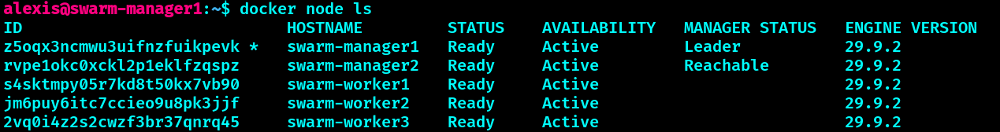
*Le cluster : 2 managers (manager1 Leader, manager2 Reachable) et 3 workers, tous `Ready` (état avant l'ajout de manager3).*

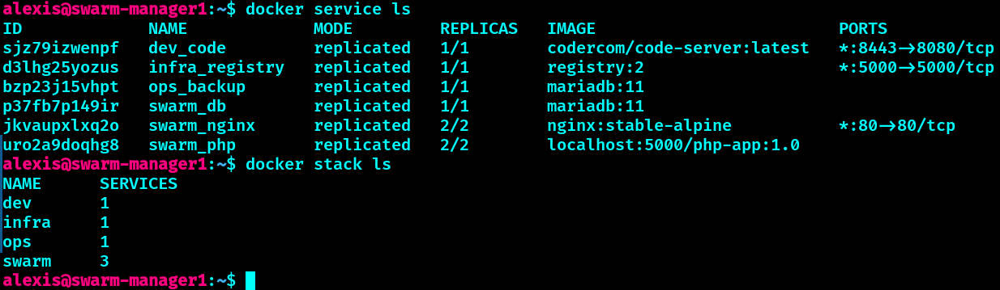
*Les 6 services et 4 stacks, réplicas au complet.*

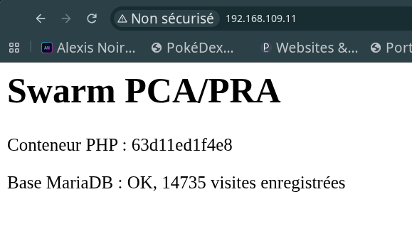
*La page de test : nom du conteneur PHP qui répond et compteur de visites stocké dans MariaDB.*

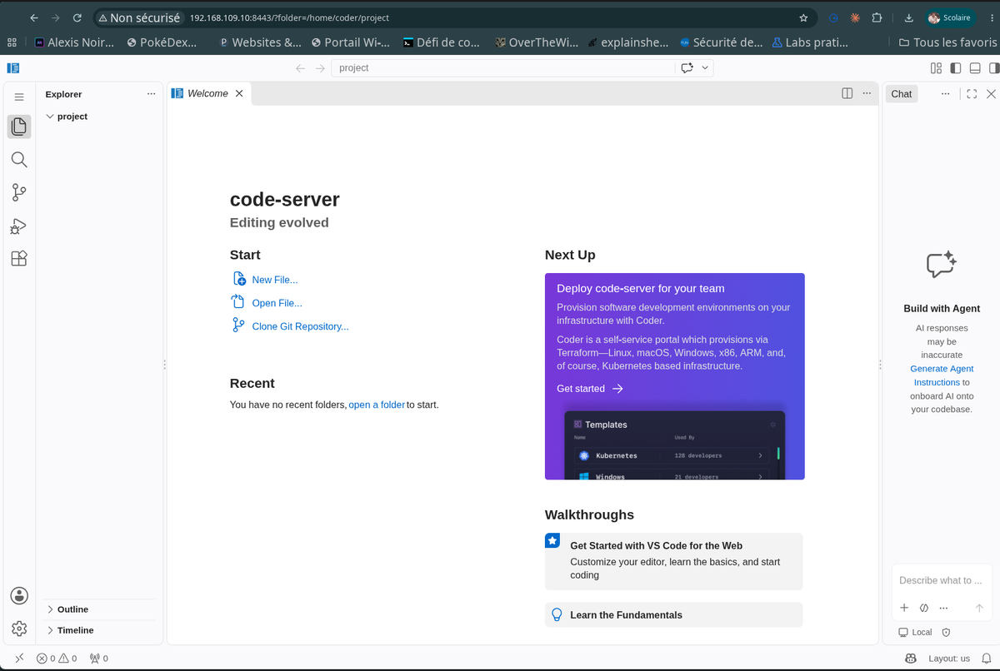
*VSCode Server (code-server) accessible sur le port 8443.*


## 🚀 Démarrage rapide

Le détail pas à pas est dans [`docs/installation.md`](docs/installation.md). En résumé, depuis `swarm-manager1` :

```bash
# 1. Initialiser le cluster
docker swarm init --advertise-addr 192.168.109.10

# 2. Créer les secrets (voir docs/installation.md)
# 3. Déployer les stacks
docker stack deploy -c stack/registry.yml infra
docker stack deploy --with-registry-auth -c stack/docker-stack.yml swarm
docker stack deploy -c stack/code.yml dev
docker stack deploy -c stack/backup.yml ops

# 4. Vérifier
scripts/healthcheck.sh
```

Aucun secret n'est stocké dans ce dépôt : mots de passe, clés et certificats sont créés sur le cluster et exclus par le `.gitignore`.

## 🧪 Tests de résilience

Résultats mesurés, détaillés dans [`docs/tests.md`](docs/tests.md) :

| Test | Scénario | Résultat |
| --- | --- | --- |
| 1 | Perte d'un conteneur PHP (`docker kill`) | Recréé sur un autre worker en 4 à 6 s, site disponible |
| 2 | Perte du conteneur MariaDB | Indisponibilité d'environ 5 s côté appli, retour complet en moins de 30 s, aucune donnée perdue |
| 3 | Coupure brutale d'un worker entier | Services recréés sur les autres workers, site disponible |
| 4 | Perte d'un manager (2 managers) | Site disponible, cluster non pilotable : repris en 13 à 32 s avec `--force-new-cluster` (voir [`pca-pra.md`](docs/pca-pra.md#perte-dun-manager)) |
| 6 | Perte d'un manager (3 managers) | Cluster **toujours pilotable**, aucune reprise manuelle, retour automatique du manager (voir [`pca-pra.md`](docs/pca-pra.md#haute-disponibilité-des-managers-3-managers)) |
| 7 | Perte du Leader (3 managers) | Nouveau Leader élu en moins de 25 s, cluster pilotable, site disponible, retour automatique de l'ancien Leader |

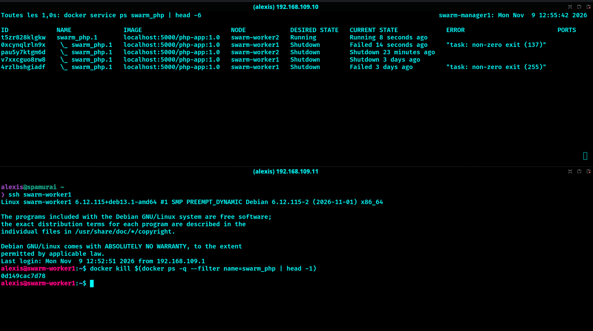
*Test 1 : le conteneur PHP tué (code 137) est remplacé sur worker2 en environ 6 secondes.*

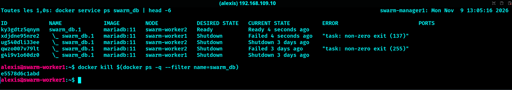
*Test 2 : la base tuée est replanifiée sur un autre worker.*

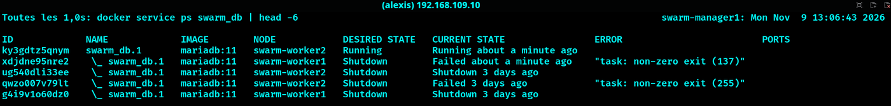
*Test 2 : la base est de nouveau `Running`, ses données sont sur le NFS.*

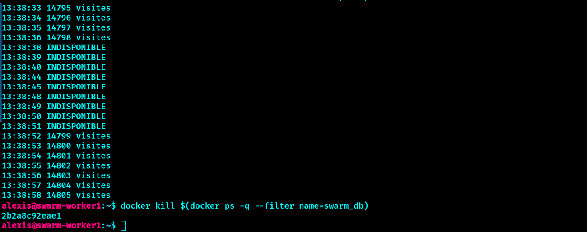
*Test 2 : une requête par seconde. Le compteur monte jusqu'à 14 798, la base est indisponible environ 14 s, puis le compteur reprend à 14 799 : aucune donnée perdue.*

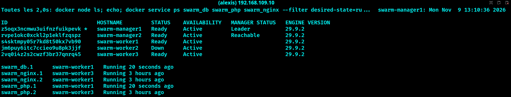
*Test 3 : worker2 coupé brutalement (`Down`), ses tâches sont recréées sur worker1.*


## 🔁 PCA / PRA

| Indicateur | Valeur mesurée |
| --- | --- |
| **PCA** (continuité) | Web : continuité assurée par 2 réplicas Nginx/PHP et le routing mesh. Base : relance automatique en moins de 30 s |
| **PRA** (reprise) | Sauvegarde horaire des bases, restauration testée après un `DROP DATABASE` |
| **RTO** (temps de reprise) | environ 24 s (restauration manuelle) |
| **RPO** (perte de données) | 3 visites perdues lors du test ; 1 heure au maximum en théorie (fréquence des dumps) |
| Sauvegarde de l'état Swarm | archive de `/var/lib/docker/swarm` conservée sur le NFS |

Procédures complètes : [`docs/pca-pra.md`](docs/pca-pra.md).

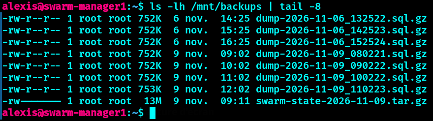
*Un dump compressé par heure sur le NFS, plus l'archive de l'état Swarm.*

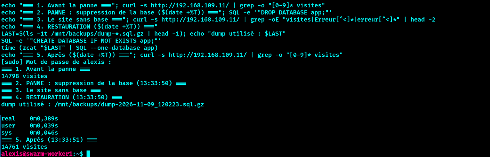
*Restauration : base supprimée à 13:33:50, restaurée à 13:33:51 (import en 0,39 s), 37 visites perdues (RPO).*


## 🔒 Sécurité

- **Registry** en HTTPS (CA locale) avec authentification ; les workers reçoivent les identifiants avec `--with-registry-auth`.
- **Secrets Swarm** pour tous les mots de passe (base, code-server) : montés dans `/run/secrets`, jamais en variable d'environnement ni dans Git.
- **Pare-feu `ufw`** sur chaque VM, en refus par défaut : seuls les ports Swarm utiles et NFS sont ouverts, restreints au sous-réseau.
- **SSH** par clé uniquement, connexion root et mots de passe désactivés.
- Moindre privilège : 2377/tcp (gestion du cluster) n'est ouvert que sur les managers.

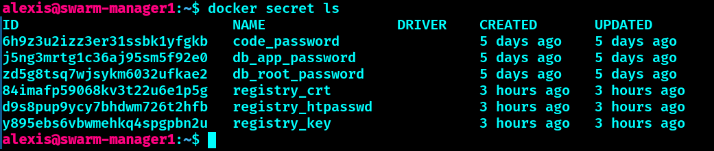
*Les secrets Swarm : mots de passe de la base, de code-server et éléments TLS de la registry.*

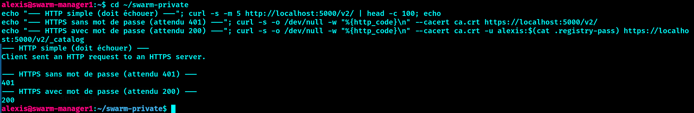
*Registry : HTTP refusé, HTTPS sans mot de passe refusé (401), HTTPS authentifié accepté (200).*

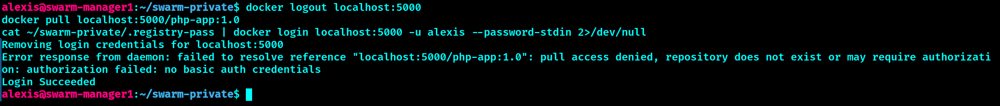
*Sans identifiants, le `docker pull` est refusé ; la reconnexion fonctionne.*

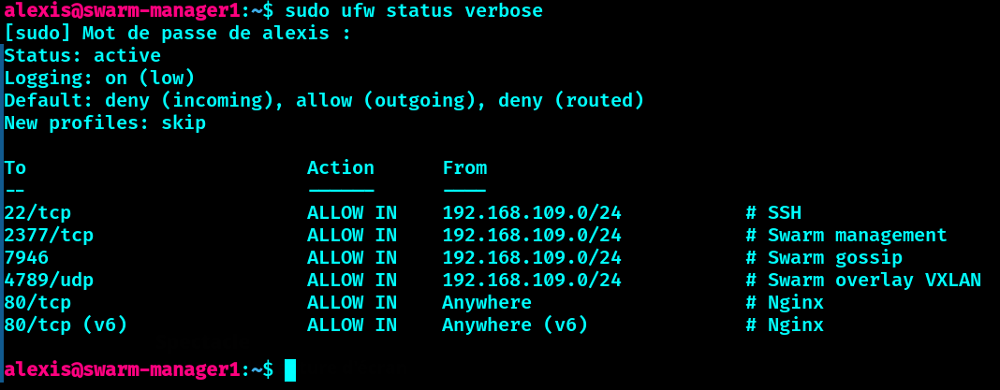
*Pare-feu d'un manager : 2377/tcp ouvert uniquement depuis le sous-réseau.*

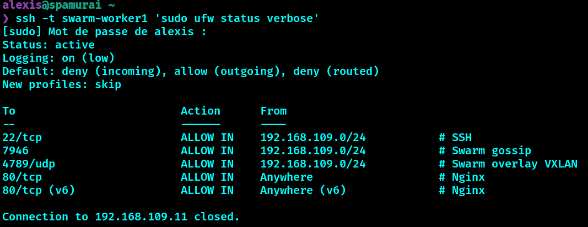
*Pare-feu d'un worker : pas de 2377 (moindre privilège).*

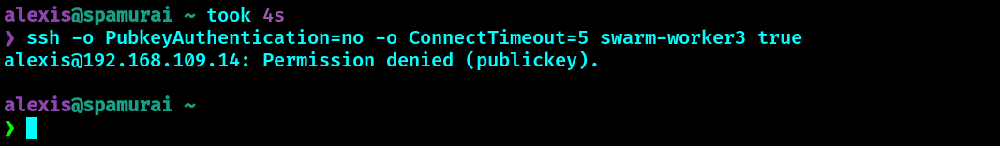
*SSH sans la clé : `Permission denied (publickey)`.*


## 📊 Supervision

[`scripts/healthcheck.sh`](scripts/healthcheck.sh) vérifie en une commande l'état des nœuds, des services, du site sur chaque IP, de la registry et de la fraîcheur des sauvegardes. La fraîcheur des sauvegardes est lue directement sur le NFS (montage en lecture seule). Il tourne toutes les 5 minutes via `cron` et écrit dans un journal.

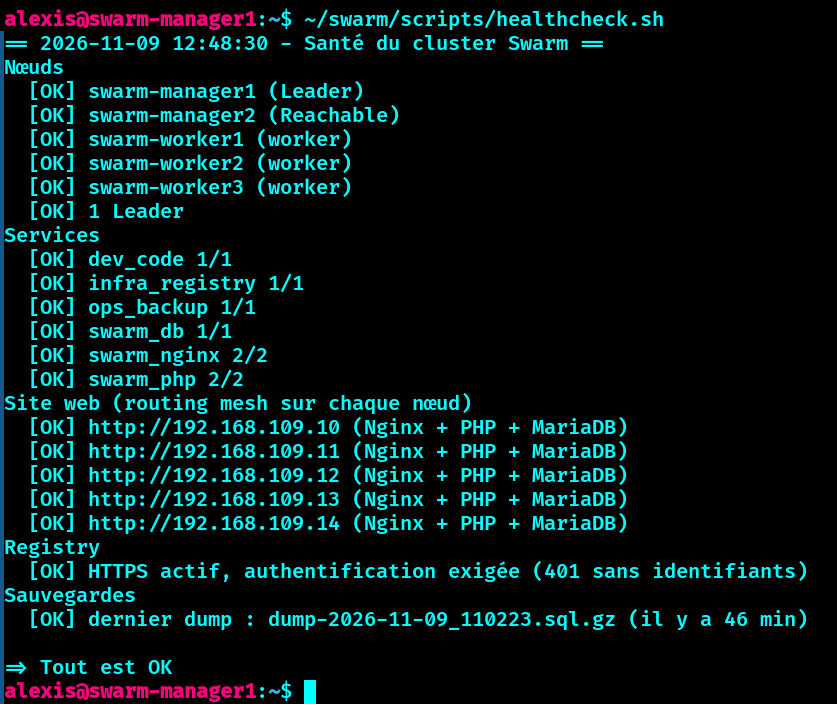
*Cluster sain : tous les contrôles sont `[OK]`.*

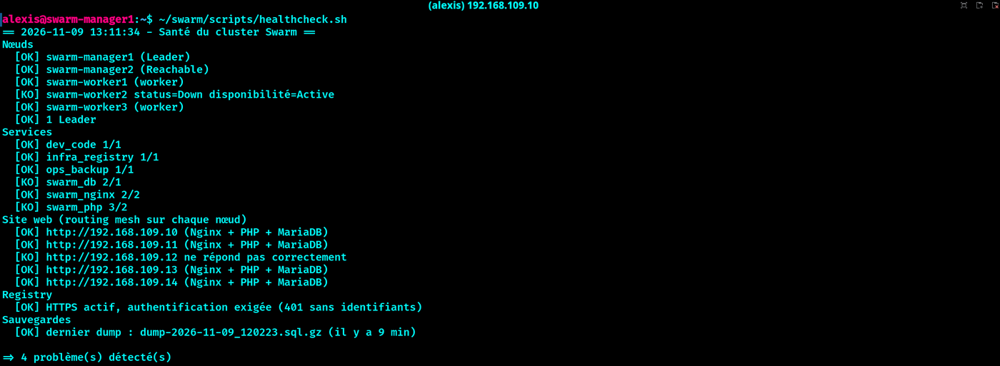
*Pendant la panne de worker2 : le script détecte le nœud `Down`, l'IP muette et les services en transition.*

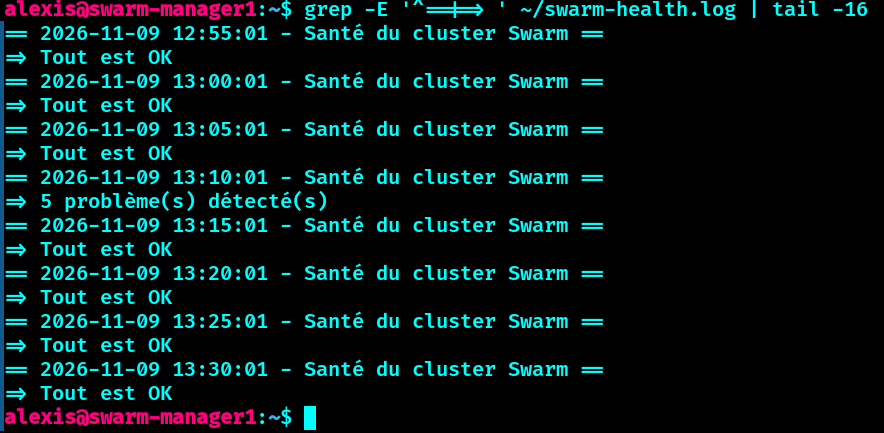
*Le journal cron : un bilan toutes les 5 minutes, avec le `[KO]` de 13:10 (panne de worker2) puis le retour à `Tout est OK`.*


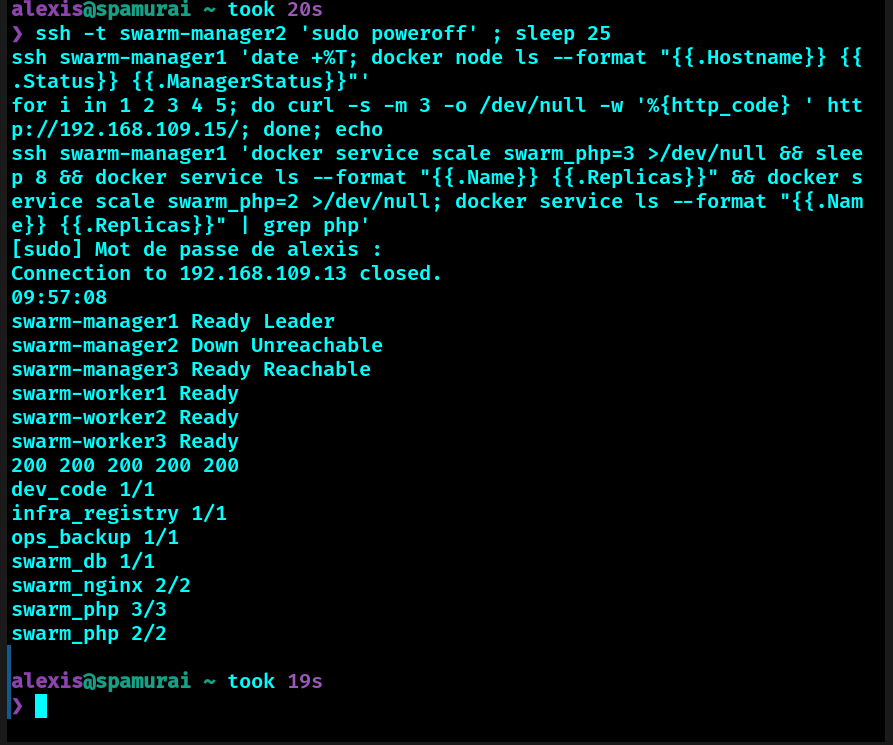
*Test 6 : avec 3 managers, manager2 éteint, le cluster reste pilotable et le site répond.*

## ⚠️ Limites assumées

- **MariaDB** n'est pas en haute disponibilité au sens strict : un seul réplica, relancé automatiquement ailleurs (basculement). Un cluster Galera à 3 nœuds serait l'étape suivante.
- **Trois managers** tolèrent la perte d'un seul manager (quorum 2 sur 3) ; deux pannes simultanées exigeraient une reprise forcée. Cinq managers en tolèreraient deux.
- Le **serveur NFS** est un point de défaillance unique.
- La **registry** utilise une CA auto-signée (laboratoire) et le mot de passe de connexion est stocké en clair dans `~/.docker/config.json` du manager.
- Docker publie les ports 80, 5000 et 8443 en contournant `ufw` ; en production, on filtrerait via la chaîne `DOCKER-USER`.
- La supervision tourne sur un seul manager et n'envoie pas d'alertes.

## 📁 Structure du dépôt

```
swarm/
├── README.md
├── .gitignore
├── stack/
│   ├── registry.yml        # stack infra : registry HTTPS + auth
│   ├── docker-stack.yml    # stack swarm : MariaDB, PHP, Nginx
│   ├── code.yml            # stack dev : VSCode Server
│   ├── backup.yml          # stack ops : dump horaire
│   ├── nginx/default.conf
│   └── php/Dockerfile
├── app/index.php           # page de test (PHP + MariaDB)
├── scripts/
│   ├── healthcheck.sh      # supervision du cluster
│   ├── firewall.sh         # ufw par rôle (manager|worker|nfs)
│   └── ssh-harden.sh       # SSH par clé uniquement
└── docs/
    ├── installation.md
    ├── tests.md
    ├── pca-pra.md
    └── images/             # captures d'écran
```

## 🎓 Compétences démontrées

### ➔ Administrer et sécuriser les infrastructures systèmes

- Installation et configuration de 6 VM Debian 13 : adressage fixe, résolution de noms, serveur NFS, comptes et droits (`sudo`, groupes).
- Pare-feu `ufw` en refus par défaut, règles par rôle (manager, worker, NFS) restreintes au sous-réseau.
- Accès SSH par clé uniquement, connexion root désactivée.
- Sauvegardes horaires de la base, archive de l'état du cluster, procédure de restauration testée et chronométrée.

### ➔ Administrer et sécuriser les infrastructures virtualisées

- Cluster Docker Swarm de 6 nœuds sous VMware : managers, workers, réseau overlay, stacks, contraintes de placement, routing mesh.
- Registry interne en HTTPS (CA locale) avec authentification ; identifiants transmis aux workers avec `--with-registry-auth`.
- Secrets Swarm pour tous les mots de passe, jamais dans le dépôt ni en variable d'environnement.
- Pannes simulées et résolues : conteneur, base, worker entier, manager (reprise avec `--force-new-cluster`), incident de base de tâches après coupure brutale, état réseau périmé d'un manager.

### ➔ Concevoir une solution technique répondant à des besoins d'évolution de l'infrastructure

- Architecture pensée pour la continuité : séparation managers / workers / stockage, réplicas Nginx et PHP, données persistantes sur NFS pour que tout conteneur puisse être replacé ailleurs.
- PCA/PRA avec objectifs mesurés (RTO environ 24 s, RPO de 1 h au maximum).
- Limites identifiées et assumées : base en basculement et non en cluster, 3 managers (une seule panne de manager tolérée), NFS en point unique de défaillance.
- Pistes d'évolution documentées : 3 managers, MariaDB Galera, réplication hors cluster des sauvegardes, certificats d'une autorité reconnue.

### ➔ Mettre en œuvre et optimiser la supervision des infrastructures

- Script de contrôle de santé (nœuds, services, site sur chaque IP, registry, fraîcheur des sauvegardes) exécuté toutes les 5 minutes avec journal.
- Optimisation de la sonde de sauvegarde : lecture de l'âge du dernier dump sur le NFS plutôt que des logs de service, instables par intermittence.
- Pistes d'évolution : alertes automatiques, supervision par métriques (Prometheus, Grafana).

## 👤 Auteur

**Alexis Noiret** — Bachelor IT Cybersécurité, La Plateforme

- 🌐 Portfolio : [alexis-noiret.students-laplateforme.io](https://alexis-noiret.students-laplateforme.io)
- 🐙 GitHub : [github.com/alexis-noiret](https://github.com/alexis-noiret)
