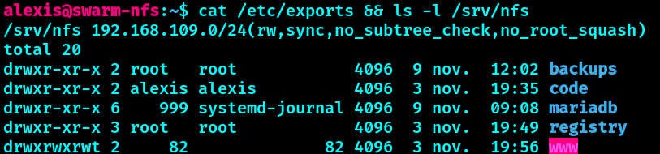
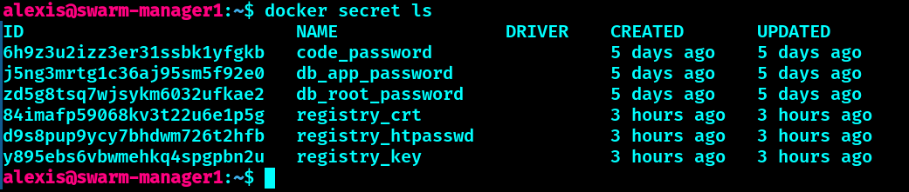

# 🛠️ Installation pas à pas

Procédure de reconstruction complète. Les valeurs (IP, noms) sont celles du laboratoire.

## 1. Les VM

6 VM Debian 13 sous VMware Workstation, réseau NAT `192.168.109.0/24` (passerelle `192.168.109.2`).

| VM | IP |
| --- | --- |
| swarm-manager1 | 192.168.109.10 |
| swarm-manager2 | 192.168.109.13 |
| swarm-worker1 | 192.168.109.11 |
| swarm-worker2 | 192.168.109.12 |
| swarm-worker3 | 192.168.109.14 |
| swarm-nfs | 192.168.109.20 |

Sur chaque VM :

- IP fixe dans `/etc/network/interfaces` (`address <IP>/24`, `gateway 192.168.109.2`) ;
- les 6 noms dans `/etc/hosts` ;
- DNS : `printf "nameserver 1.1.1.1\nnameserver 192.168.109.2\n" | sudo tee /etc/resolv.conf` (à refaire après le premier redémarrage si le fichier est réécrit) ;
- `sudo` installé et l'utilisateur dans les groupes `sudo` et `docker` (se reconnecter pour que les groupes s'appliquent).

Clé SSH de l'utilisateur déposée sur toutes les VM. Entrée type dans `~/.ssh/config` du poste de travail :

```
Host swarm-*
    User alexis
    IdentityFile ~/.ssh/id_ed25519_github
    IdentitiesOnly yes
Host swarm-manager1
    HostName 192.168.109.10
```

## 2. Docker

Installation depuis le dépôt officiel Docker sur les 5 nœuds du cluster (pas sur le serveur NFS).

## 3. Serveur NFS (swarm-nfs)

```bash
sudo apt-get install -y nfs-kernel-server
sudo mkdir -p /srv/nfs/{mariadb,registry,www,code,backups}
sudo chown 999:999   /srv/nfs/mariadb     # utilisateur mariadb
sudo chown 82:82     /srv/nfs/www         # www-data des images Alpine (php-fpm, nginx)
sudo chmod 1777      /srv/nfs/www         # permissif en laboratoire ; 755 suffit en production
sudo chown 1000:1000 /srv/nfs/code        # utilisateur coder
echo '/srv/nfs 192.168.109.0/24(rw,sync,no_subtree_check,no_root_squash)' | sudo tee /etc/exports
sudo exportfs -ra && sudo systemctl enable --now nfs-kernel-server
```

Les UID correspondent aux utilisateurs internes de chaque image (le `www-data` des images Alpine a l'UID 82, pas 33 comme sur Debian). Résultat attendu :


*Export du sous-réseau et propriétaires des dossiers : mariadb (999), www (82), code (1000).*

Copier ensuite la page de test [`app/index.php`](../app/index.php) dans `/srv/nfs/www/`.

## 4. Le cluster

Sur manager1 :

```bash
docker swarm init --advertise-addr 192.168.109.10
docker swarm join-token worker       # à exécuter sur les 3 workers
docker swarm join-token manager      # à exécuter sur manager2
docker node ls                       # 2 managers + 3 workers
```

## 5. Secrets

Trois mots de passe aléatoires sont créés directement dans Swarm (jamais dans un fichier versionné). Résultat final :


*`docker secret ls` : les trois secrets applicatifs et les trois éléments TLS de la registry (le contenu n'est jamais affiché).*

Les commandes de création :

```bash
for s in db_root_password db_app_password code_password; do
  openssl rand -base64 24 | tr -d '\n' | docker secret create $s -
done
```

## 6. Registry sécurisée (CA locale, HTTPS, mot de passe)

Le nom d'accès reste `localhost:5000` (routing mesh) : les fichiers de stack n'ont pas besoin de changer.

```bash
# Sur manager1, dans un dossier HORS du dépôt
mkdir -p ~/swarm-private && cd ~/swarm-private && chmod 700 .
openssl genrsa -out ca.key 4096
openssl req -x509 -new -nodes -key ca.key -sha256 -days 825 -subj "/CN=Swarm Registry CA" -out ca.crt
openssl genrsa -out registry.key 4096
openssl req -new -key registry.key -subj "/CN=localhost" -out registry.csr
printf "subjectAltName=DNS:localhost,IP:127.0.0.1\nextendedKeyUsage=serverAuth\n" > san.ext
openssl x509 -req -in registry.csr -CA ca.crt -CAkey ca.key -CAcreateserial -out registry.crt -days 825 -sha256 -extfile san.ext
openssl rand -base64 18 | tr -d '/+=' > .registry-pass && chmod 600 .registry-pass
docker run --rm --entrypoint htpasswd httpd:2 -Bbn alexis "$(cat .registry-pass)" > htpasswd

docker secret create registry_crt registry.crt
docker secret create registry_key registry.key
docker secret create registry_htpasswd htpasswd
```

Faire approuver la CA par Docker sur **chacun des 5 nœuds** :

```bash
sudo mkdir -p /etc/docker/certs.d/localhost:5000
sudo cp ca.crt /etc/docker/certs.d/localhost:5000/ca.crt
```

## 7. Déploiement des stacks

```bash
docker stack deploy -c stack/registry.yml infra
cat ~/swarm-private/.registry-pass | docker login localhost:5000 -u alexis --password-stdin

# Construire et publier l'image PHP
docker build -t localhost:5000/php-app:1.0 stack/php
docker push localhost:5000/php-app:1.0

docker stack deploy --with-registry-auth -c stack/docker-stack.yml swarm
docker stack deploy -c stack/code.yml dev
docker stack deploy -c stack/backup.yml ops
```

Vérification : `docker service ls`, puis `curl http://192.168.109.11/` (affiche le nom du conteneur PHP et le compteur de visites). VSCode Server : `http://192.168.109.10:8443` (mot de passe : `docker secret` `code_password`, à lire depuis le conteneur).

## 8. Durcissement

Sur chaque VM, avec le script adapté au rôle (`manager`, `worker` ou `nfs`) :

```bash
sudo bash scripts/firewall.sh manager
sudo bash scripts/ssh-harden.sh
```

Contrôler d'abord que la connexion par clé fonctionne : `ssh -o PasswordAuthentication=no swarm-worker1 hostname`.

## 9. Supervision

Le contrôle des sauvegardes lit le NFS directement (âge du dernier dump), ce qui est plus fiable que les logs de service. Monter le dossier en lecture seule sur le manager qui exécute le script :

```bash
sudo apt-get install -y nfs-common
sudo mkdir -p /mnt/backups
echo '192.168.109.20:/srv/nfs/backups /mnt/backups nfs4 ro,_netdev,nofail,x-systemd.automount 0 0' | sudo tee -a /etc/fstab
sudo systemctl daemon-reload && sudo mount /mnt/backups
```

Puis programmer le script :

```bash
chmod +x scripts/healthcheck.sh
(crontab -l 2>/dev/null; echo '*/5 * * * * $HOME/swarm/scripts/healthcheck.sh >> $HOME/swarm-health.log 2>&1') | crontab -
```

## Problèmes courants

| Symptôme | Cause | Solution |
| --- | --- | --- |
| `sudo : commande introuvable` | Debian minimale sans sudo | `su -`, `apt install sudo`, `usermod -aG sudo <user>`, se reconnecter |
| Erreur `apt` sur un dépôt cdrom | ligne `deb cdrom` restante | la commenter dans `/etc/apt/sources.list` |
| SSH « Connection refused » sur une VM clonée | clés d'hôte absentes | `sudo ssh-keygen -A && sudo systemctl restart ssh` |
| DNS vide après le premier redémarrage | `resolv.conf` réécrit | refaire l'étape DNS |
| Nginx renvoie 403 | `index.php` absent du NFS | copier `app/index.php` dans `/srv/nfs/www/` |
| Un manager ne répond pas sur le port 80 après un `--force-new-cluster` | table VXLAN des workers périmée | `sudo systemctl restart docker` sur ce manager (voir `pca-pra.md`) |
