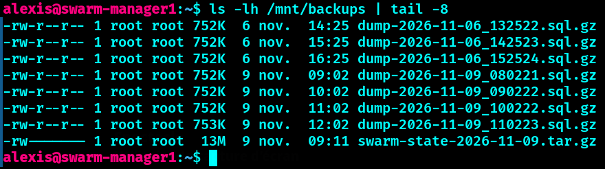
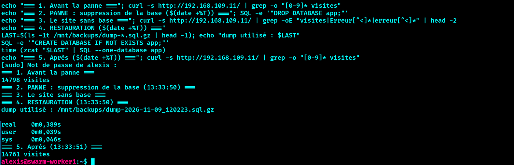
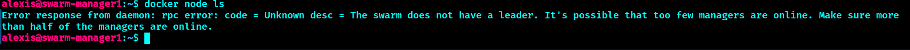
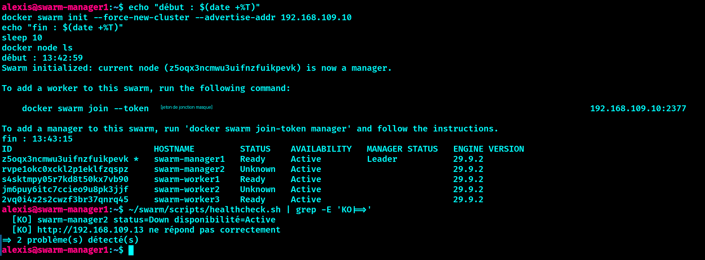
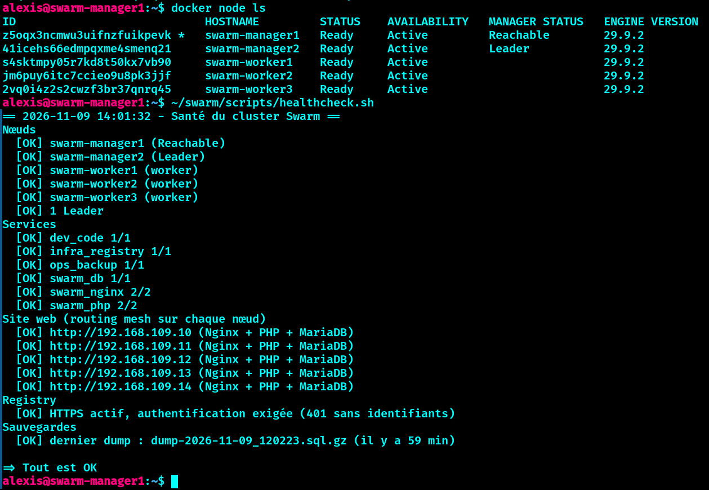
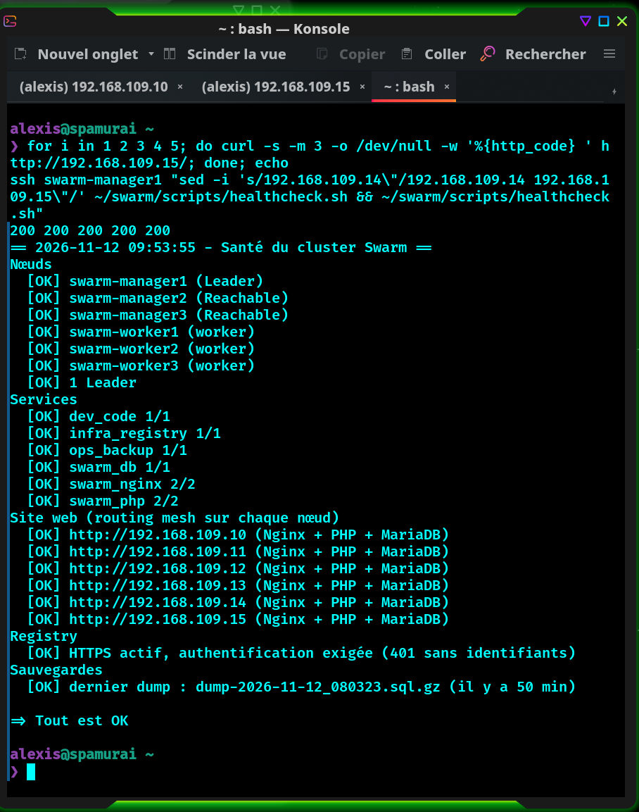
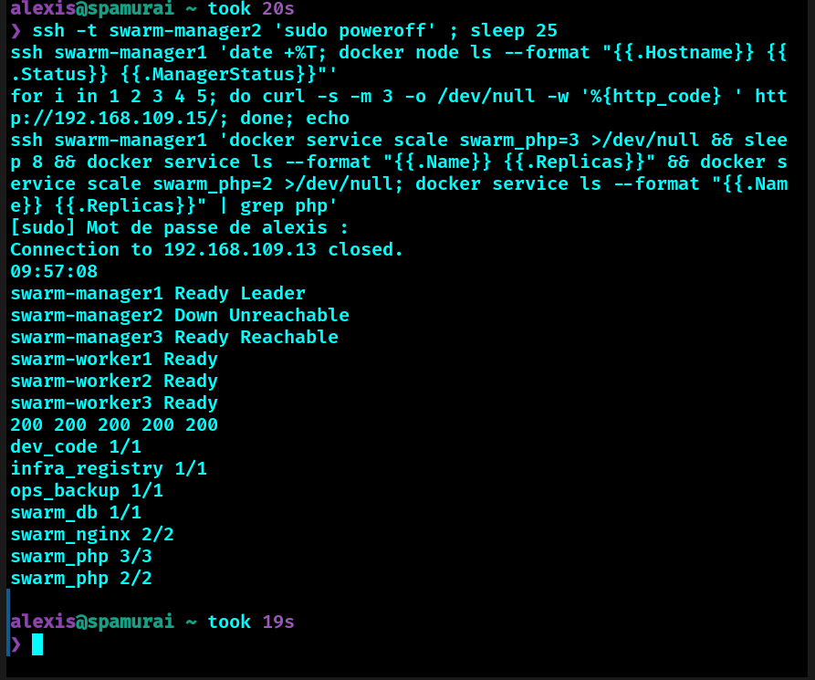
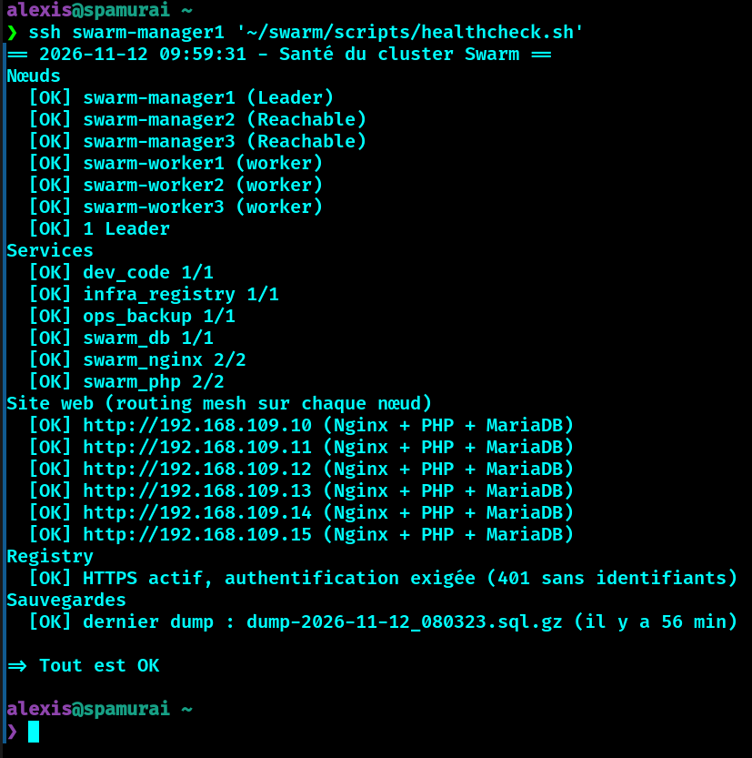
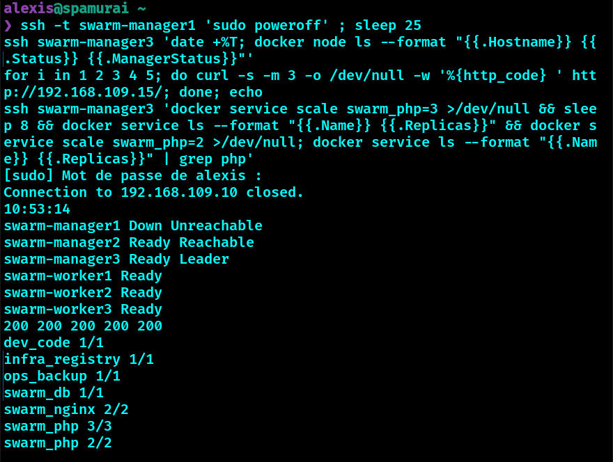
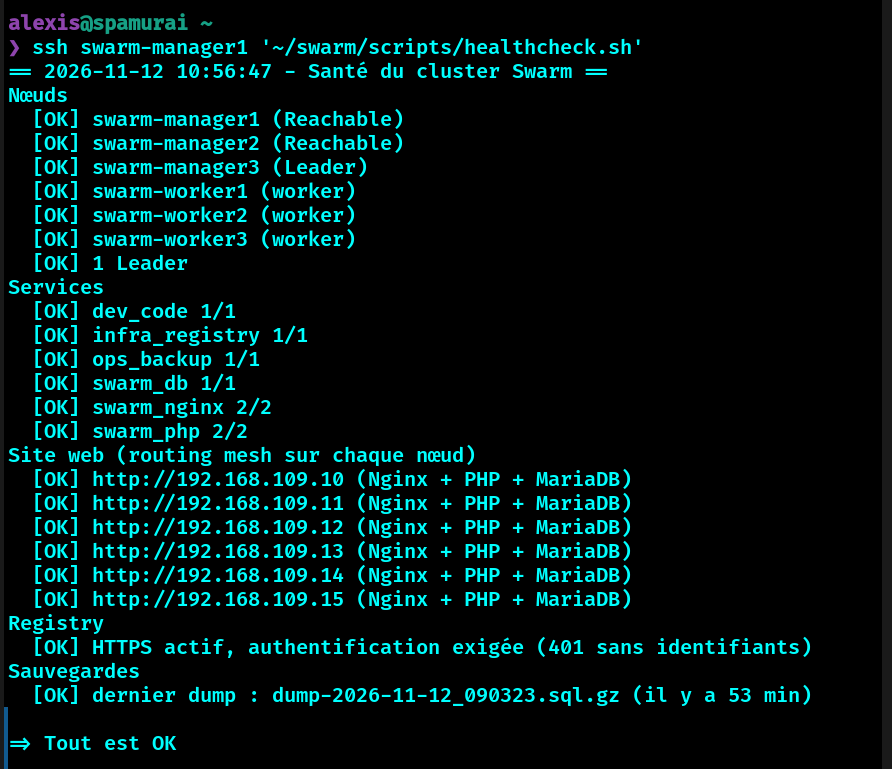

# 🔁 PCA / PRA

## Définitions

| Terme | Sens dans ce projet |
| --- | --- |
| **PCA** (Plan de Continuité d'Activité) | Le service continue de fonctionner pendant la panne, sans intervention : réplicas Nginx/PHP, recréation automatique des conteneurs, routing mesh |
| **PRA** (Plan de Reprise d'Activité) | Après un sinistre qui a détruit des données ou le cluster, on remet le service en état à partir de sauvegardes |
| **RTO** | Temps maximal pour rétablir le service |
| **RPO** | Quantité maximale de données qu'on accepte de perdre (liée à la fréquence des sauvegardes) |

## PCA : ce qui protège en continu

| Panne | Mécanisme | Effet mesuré |
| --- | --- | --- |
| Conteneur PHP ou Nginx | 2 réplicas, recréation automatique | aucune coupure |
| Conteneur MariaDB | recréation sur un autre worker, données sur le NFS | environ 5 s d'erreur, retour en moins de 30 s |
| Worker entier | replacement des tâches sur les autres workers | aucune coupure du site |
| Manager | le site continue (les workers n'ont pas besoin du manager pour servir) ; le pilotage du cluster est perdu jusqu'à la reprise | voir ci-dessous |

## PRA : sauvegardes

### Dumps MariaDB (automatiques)

Le service `ops_backup` (stack `ops`, [`stack/backup.yml`](../stack/backup.yml)) exécute en boucle :

1. un `mariadb-dump --single-transaction --all-databases` vers `/backups/dump-<date>.sql` ;
2. un contrôle que le fichier n'est pas vide, puis une compression gzip ;
3. en cas d'échec, une nouvelle tentative après 60 s (observé après un redémarrage du cluster) ;
4. la suppression des dumps de plus de 7 jours ;
5. une pause d'une heure.

Les dumps sont sur le NFS : `/srv/nfs/backups/dump-AAAA-MM-JJ_HHMMSS.sql.gz`. **RPO théorique : 1 heure.**


*Un dump toutes les heures (environ 750 Ko chacun) et l'archive de l'état Swarm (accès restreint, root uniquement). Les noms sont en UTC, les horodatages de fichiers en heure locale.*


### État du cluster Swarm (manuel)

À faire après chaque changement important de topologie, sur un manager :

```bash
sudo systemctl stop docker
sudo tar czf swarm-state-$(date +%F).tar.gz -C /var/lib/docker swarm
sudo systemctl start docker
sudo chmod 600 swarm-state-*.tar.gz        # contient les clés de chiffrement des secrets
```

Copier ensuite l'archive hors du cluster (le NFS est un point de défaillance unique). Cette archive contient les secrets : ne jamais la versionner.

### Sauvegardes à conserver hors du cluster

| Élément | Où | Pourquoi |
| --- | --- | --- |
| Dumps MariaDB | `/srv/nfs/backups` (copier hors du NFS pour un vrai PRA) | restauration des données |
| Archive de l'état Swarm | idem | recréer le cluster et ses secrets |
| Autorité de certification (`ca.key`, `ca.crt`) | `~/swarm-private` sur manager1 | signer de nouveau les certificats de la registry |
| Fichiers de stack | ce dépôt Git | redéployer les services |

## Restauration de la base

Scénario testé : la base `app` est supprimée par erreur.

```bash
# 1. Sur le worker qui héberge swarm_db
DB=$(docker ps -q --filter name=swarm_db)
docker exec -i $DB sh -c 'mariadb -u root -p"$(cat /run/secrets/db_root_password)"' <<< "DROP DATABASE app;"    # la panne

# 2. Restauration depuis le dernier dump (monté depuis le NFS)
LAST=$(ls -1t /mnt/backups/dump-*.sql.gz | head -1)
docker exec -i $DB sh -c 'mariadb -u root -p"$(cat /run/secrets/db_root_password)" -e "CREATE DATABASE IF NOT EXISTS app"'
time (zcat "$LAST" | docker exec -i $DB sh -c 'mariadb -u root -p"$(cat /run/secrets/db_root_password)" --one-database app')

# 3. Vérification
curl -s http://192.168.109.11/ | grep -o "[0-9]* visites"
```

`/mnt/backups` désigne le montage NFS de `/srv/nfs/backups` sur le worker (`sudo mount -t nfs4 192.168.109.20:/srv/nfs/backups /mnt/backups`). L'option `--one-database` limite la restauration à la base `app`.

**Mesures** :

| Indicateur | Valeur |
| --- | --- |
| Panne simulée (`DROP DATABASE app`) | 09:07:53 |
| Service rétabli | 09:08:17 |
| **RTO** | environ **24 s** (manuel, dont la saisie des commandes) |
| Durée de l'import seul | 0,67 s |
| **RPO** | compteur à 14 570 avant la panne, 14 567 après : **3 visites perdues** (au plus 1 h en théorie) |

**Seconde mesure, scriptée** : suppression à 13:33:50, base restaurée à 13:33:51, import de **0,39 s**. Le compteur passe de 14 798 à 14 761 : **37 visites perdues**, soit celles des 31 minutes écoulées depuis le dernier dump (13:02). Le RPO dépend donc du moment de la panne dans l'heure : de quelques secondes juste après un dump à 1 h juste avant le suivant.


*Avant : 14 798 visites. Suppression à 13:33:50, restauration à 13:33:51 (import en 0,39 s). Après : 14 761 visites.*


## Perte d'un manager

Avec **2 managers** (configuration initiale du projet, avant l'ajout de manager3), le quorum Raft exige 2 voix sur 2 : si l'un tombe, le cluster **ne peut plus être piloté**. Les services déjà lancés continuent de tourner : le site reste disponible (à interroger sur l'IP d'un worker).

Scénario testé : `swarm-manager2` est coupé brutalement (VMware : *Power Off*). Sur le manager restant, `docker node ls` échoue d'abord par un dépassement de délai, puis répond « The swarm does not have a leader », alors que le site répond toujours `200`.


*Sans manager2, manager1 n'a plus le quorum : « The swarm does not have a leader. Make sure more than half of the managers are online. »*

### Procédure de reprise

Sur le manager restant (ici manager1) :

```bash
docker swarm init --force-new-cluster --advertise-addr 192.168.109.10
docker node ls          # le manager restant est Leader, le manager perdu est Unknown, les services sont intacts
```

Mesures : **13 secondes** (13:50:21 → 13:50:34) pour `--force-new-cluster` sur le dernier essai, 32 secondes (pause de 10 s comprise) sur le premier essai avec l'autre manager. Les services n'ont jamais été interrompus.


*Reprise forcée : manager1 devient Leader, manager2 est `Unknown`. Le jeton de jonction des workers affiché par cette commande a été masqué sur la capture.*

> **Sécurité** : `docker swarm init --force-new-cluster` affiche le jeton de jonction des workers. Ne jamais le copier dans un dépôt ni dans une capture d'écran, et le renouveler au besoin : `docker swarm join-token --rotate worker`.

### Réintégrer le manager perdu

À lancer **une seule fois**, depuis le poste de travail ; le jeton de jonction passe d'une machine à l'autre sans jamais s'afficher :

```bash
ssh swarm-manager2 'docker swarm leave --force' || true
ssh swarm-manager1 'docker node rm --force swarm-manager2' || true
ssh swarm-manager1 'docker swarm join-token -q manager' | ssh swarm-manager2 'read T; docker swarm join --token "$T" 192.168.109.10:2377'
```

Le manager réintégré reçoit un nouvel identifiant.


*Après réintégration et redémarrage de Docker sur manager1 : 2 managers (manager2 Leader, manager1 Reachable), 3 workers `Ready`, site sur les 5 IP, `=> Tout est OK`.*

**Ne pas rejouer ce bloc** une fois manager2 revenu : le second `leave` fait ressortir manager2 en le laissant déclaré comme membre manager (erreur « must be demoted to worker before removal »), et manager1 perd de nouveau son quorum. Il faut alors refaire une reprise forcée, puis réintégrer manager2.

### Piège rencontré : le routing mesh du manager récupéré

Après le `--force-new-cluster`, le manager récupéré ne répond plus sur le port 80 : les paquets de son réseau overlay arrivent bien sur les workers, mais ces derniers n'ont pas son point d'entrée dans leur table VXLAN et ne peuvent pas lui répondre. Ni le pare-feu ni la configuration ne sont en cause. Observé sur manager2 lors du premier essai, puis sur manager1 lors du second : le problème est donc systématique.

Correctif : `sudo systemctl restart docker` sur ce manager (il se ré-annonce au cluster). Pendant ce redémarrage de 20 à 40 s, le cluster perd son quorum (2 managers) et le Leader change ; les services continuent de tourner.

**À retenir** : après un `--force-new-cluster`, tester le site sur chaque IP (`scripts/healthcheck.sh`) et redémarrer Docker sur le manager récupéré si une IP ne répond pas.

## Haute disponibilité des managers (3 managers)

Les tests ci-dessus ont montré qu'avec **2 managers** la perte d'un seul suffit à rendre le cluster non pilotable. Un troisième manager, `swarm-manager3` (192.168.109.15), a donc été ajouté : le quorum Raft devient **2 sur 3** et le cluster tolère la perte d'un manager sans reprise manuelle.

Ajout du nœud : clone de worker3 avec carte réseau déconnectée au premier démarrage, puis nouvelle identité (nom, IP, `machine-id`, clés SSH de l'hôte, état Swarm effacé), pare-feu `firewall.sh manager`, jonction avec `docker swarm join --token <jeton manager>` (jeton passé par ssh, sans l'afficher). Détail dans [`installation.md`](installation.md).


*Cluster à 3 managers (manager1 Leader, manager2 et manager3 Reachable), 3 workers `Ready`, site sur les 6 IP, `=> Tout est OK`.*

**Test** : manager2 est éteint (`poweroff`). Sur manager1, `docker node ls` répond (manager2 `Down / Unreachable`, manager1 reste Leader), le site renvoie `200` sur manager3 et `docker service scale swarm_php=3` aboutit. Au redémarrage, manager2 redevient `Reachable` **sans aucune manipulation** (aucun `--force-new-cluster`, aucun redémarrage de Docker).


*Manager2 éteint : `Down / Unreachable`, mais `docker node ls` répond, le site renvoie 200 et `swarm_php` passe à 3 réplicas puis revient à 2.*


*Manager2 rallumé : `Reachable` tout seul, `=> Tout est OK`.*

**Test du Leader** : manager1, qui était Leader, est éteint à son tour. En moins de 25 s, **manager3 est élu Leader** automatiquement ; le site reste en `200` sur les 5 requêtes et `docker service scale swarm_php=3` aboutit depuis manager3. Au redémarrage, manager1 revient `Reachable` tout seul et manager3 reste Leader (pas de bascule inutile).


*Manager1 (Leader) éteint : manager3 élu Leader, site en 200, `swarm_php` passe à 3 réplicas puis revient à 2.*


*Manager1 rallumé : `Reachable`, manager3 reste `Leader`, `=> Tout est OK`.*

| | 2 managers | 3 managers |
| --- | --- | --- |
| Quorum Raft | 2 sur 2 | 2 sur 3 |
| Panne d'un manager | cluster non pilotable, reprise forcée (13 à 32 s) | cluster pilotable, aucune intervention |
| Retour du manager | réintégration manuelle + redémarrage de Docker | automatique |

Limite : deux managers perdus en même temps font retomber le cluster sous le quorum ; la procédure de reprise forcée ci-dessus s'applique alors.

## Recommandations pour aller plus loin

- Passer à **5 managers** pour tolérer deux pannes simultanées, si le besoin existe.
- **MariaDB Galera** à 3 nœuds pour une vraie haute disponibilité de la base.
- Répliquer le NFS ou ses sauvegardes hors du cluster.
- Alertes automatiques à partir de `healthcheck.sh` (mail, webhook).
