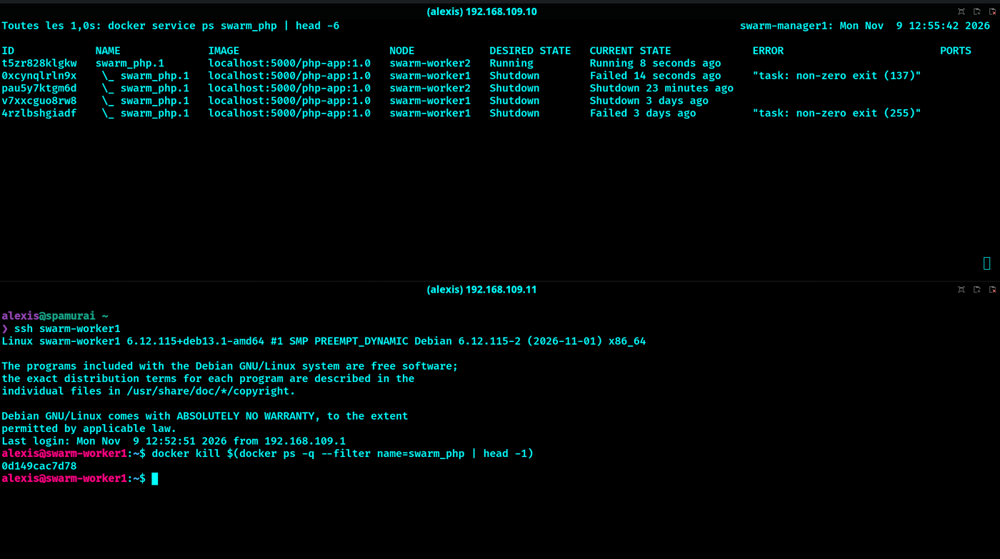
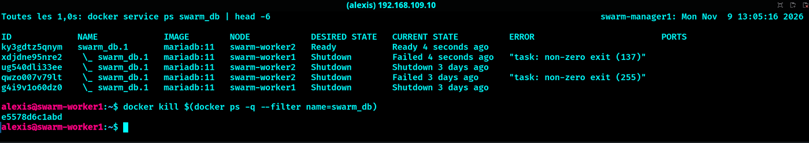
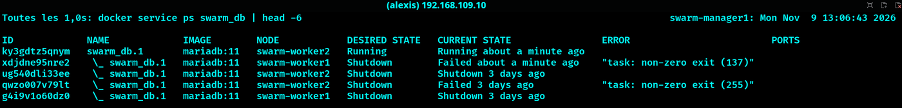
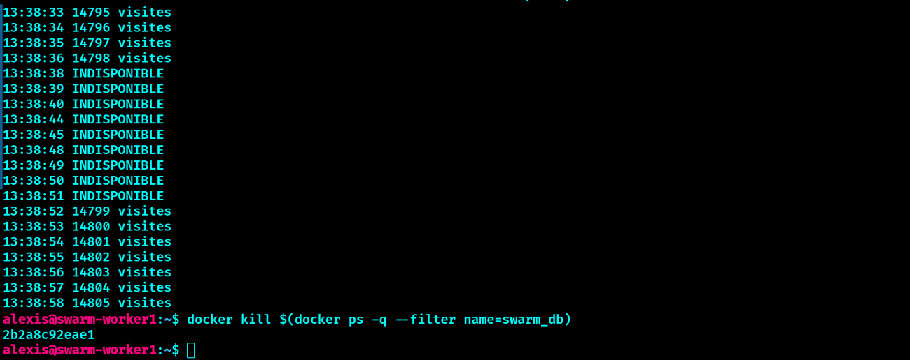
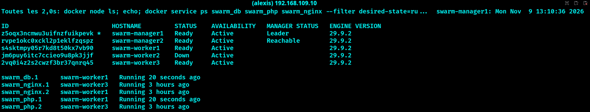
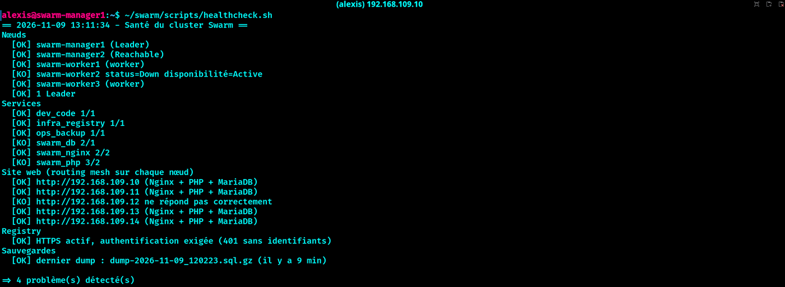
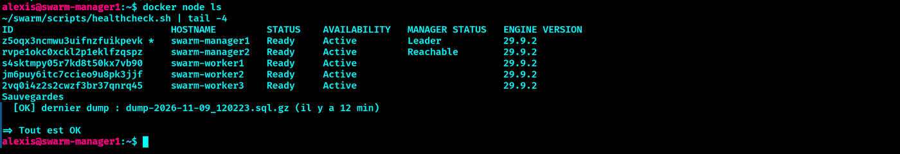
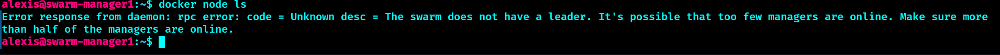
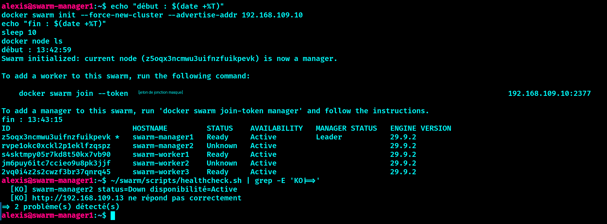
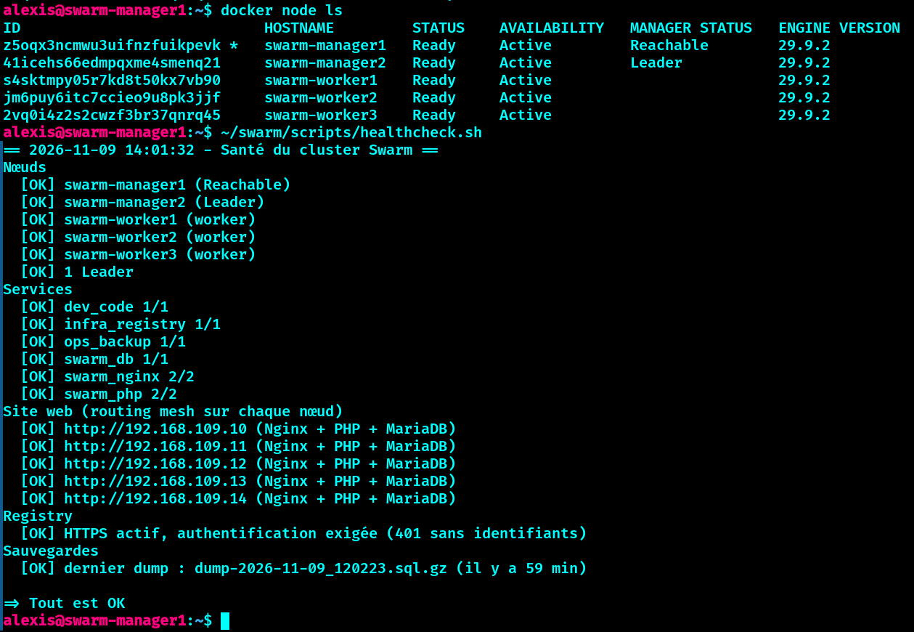

# 🧪 Procédures de test de résilience

Chaque test suit le même schéma : **objectif → état initial → action → observation → résultat attendu → résultat mesuré**. Ils sont rejouables dans l'ordre sur un cluster sain.

## Préparation commune

Vérifier l'état de départ depuis un manager :

```bash
scripts/healthcheck.sh          # doit afficher "Tout est OK"
docker service ls               # tous les services au complet
```

Dans un second terminal, lancer une surveillance continue du site (une requête par seconde) :

```bash
while true; do
  printf "%s " "$(date +%T)"
  curl -s -m 3 http://192.168.109.11/ | grep -o "[0-9]* visites" || echo "INDISPONIBLE"
  sleep 1
done
```

Chaque rechargement incrémente un compteur de visites en base : un compteur qui continue de monter prouve que la base a gardé ses données.

---

## Test 1 : perte d'un conteneur PHP

**Objectif** : vérifier que Swarm recrée un conteneur supprimé et que le site reste disponible (2 réplicas).

```bash
# Où tournent les réplicas PHP ?
docker service ps swarm_php --filter desired-state=running

# Sur le worker concerné (ssh <worker>) : identifier puis tuer le conteneur
docker ps --filter name=swarm_php --format '{{.ID}} {{.Names}}'
docker kill <ID_DU_CONTENEUR>

# Depuis un manager : observer la recréation
watch -n 1 'docker service ps swarm_php'
```

**Résultat attendu** : une nouvelle tâche apparaît (parfois sur un autre worker), la tâche tuée passe en `Failed`, le site ne s'interrompt pas car le second réplica répond.

**Résultat mesuré** : conteneur recréé sur un autre worker en **4 à 6 secondes**, aucune requête perdue sur le site.


*Tâche `Failed` (code 137) sur worker1, remplacée par une tâche `Running` sur worker2 six secondes plus tard.*


---

## Test 2 : perte du conteneur MariaDB

**Objectif** : vérifier le basculement automatique de la base et la persistance des données sur le NFS.

```bash
docker service ps swarm_db --filter desired-state=running      # trouver le worker
# Sur ce worker :
docker kill $(docker ps -q --filter name=swarm_db)
# Depuis un manager :
watch -n 1 'docker service ps swarm_db'
```

**Résultat attendu** : la base est indisponible quelques secondes, puis revient avec les mêmes données (le compteur continue, il ne repart pas de zéro).

**Résultat mesuré** : erreur de connexion pendant environ **5 secondes** (`getaddrinfo for db failed`, le temps que l'ancienne tâche disparaisse), retour à la normale en **moins de 30 secondes**, compteur de visites poursuivi (420 → 966 sur le test) : **aucune donnée perdue**.


*La tâche MariaDB de worker1 passe en `Failed`, sa remplaçante est planifiée sur worker2.*


*La nouvelle tâche est `Running` : la base a retrouvé ses données sur le NFS.*


*Mesure chronométrée avec une requête par seconde : dernière réponse à 13:38:36 (14 798 visites), indisponibilité de 13:38:38 à 13:38:51 (environ 14 secondes), reprise à 13:38:52 avec 14 799 visites. Le compteur n'est pas reparti de zéro.*


> Remarque : la base n'a qu'un réplica, c'est un basculement et non une vraie haute disponibilité (voir les limites dans le README).

---

## Test 3 : coupure brutale d'un worker

**Objectif** : simuler la panne d'une machine entière.

```bash
# Identifier le worker qui héberge le plus de services
docker service ps swarm_nginx swarm_php dev_code infra_registry --filter desired-state=running

# Éteindre brutalement la VM dans VMware : "Power > Power Off" (pas un arrêt propre)

# Depuis un manager
docker node ls                                  # le worker passe en "Down"
watch -n 2 'docker service ps swarm_nginx swarm_php infra_registry dev_code'
scripts/healthcheck.sh
```

**Résultat attendu** : le worker passe `Down` après quelques secondes, ses tâches sont recréées sur les workers restants, le site reste disponible.

**Résultat mesuré** : Nginx, PHP, code-server et la registry recréés sur worker3, site disponible tout le long.


*Seconde exécution : worker2 est `Down`, la base et PHP sont recréés sur worker1 (`Running` depuis 20 secondes).*


*Le script de supervision détecte la panne : nœud `Down`, IP muette, services en `2/1` et `3/2` (l'ancienne tâche est comptée tant que le nœud est `Down`).*


*Après le redémarrage de la VM : worker2 est de nouveau `Ready` et le script termine par `Tout est OK`.*


**Remise en service** : rallumer la VM. Si Docker refuse de redémarrer après la coupure brutale (base de tâches du worker corrompue, observé une fois), voir « Incident » ci-dessous.

### Incident observé : Docker ne redémarre pas après une coupure brutale

Symptôme : le service `docker` plante au démarrage (panic dans l'agent Swarm qui lit `tasks.db`). Correctif :

```bash
sudo systemctl stop docker.socket docker
sudo mv /var/lib/docker/swarm/worker/tasks.db /var/lib/docker/swarm/worker/tasks.db.bak
sudo systemctl reset-failed docker
sudo systemctl start docker
```

Le worker reprend ses tâches depuis l'état du cluster, aucune donnée applicative n'est perdue (elles sont sur le NFS).

---

## Test 4 : perte d'un manager

Voir [`pca-pra.md`](pca-pra.md#perte-dun-manager) : ce scénario relève de la reprise du cluster et y est détaillé avec ses temps.


*Manager2 coupé : manager1 ne peut plus piloter le cluster, le site reste disponible.*


*Reprise avec `--force-new-cluster` (jeton masqué).*


*Cluster complet de nouveau sain : `=> Tout est OK`.*

---

## Test 5 : restauration de la base (PRA)

Voir [`pca-pra.md`](pca-pra.md#restauration-de-la-base) : suppression volontaire de la base puis restauration depuis la dernière sauvegarde, avec mesure du RTO et du RPO.

---

## Tableau récapitulatif

| Test | Panne simulée | Interruption observée | Données perdues |
| --- | --- | --- | --- |
| 1 | Conteneur PHP | aucune | aucune |
| 2 | Conteneur MariaDB | environ 5 s côté appli, retour en moins de 30 s | aucune |
| 3 | Worker entier | aucune sur le site | aucune |
| 4 | Manager | aucune sur le site (cluster non pilotable jusqu'à la reprise, 13 à 32 s) | aucune |
| 5 | Base supprimée | 24 s (restauration manuelle) | 3 visites (RPO) |
